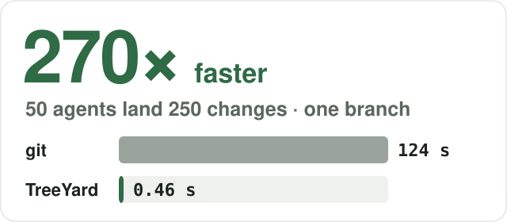
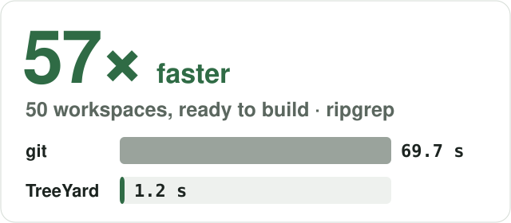
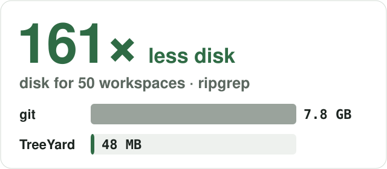
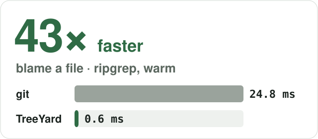
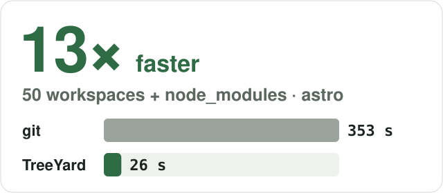
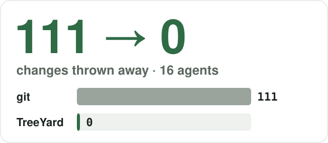

<p align="center">
  
</p>

<h3 align="center">Git for agent swarms. One server for every agent. No merge hell.</h3>

<p align="center">
  
  
  
  
  
  
  
  
  
</p>

<p align="center"><b>Install</b> · macOS, Linux · arm64, x86_64 · checks the SHA-256</p>

```bash
curl -fsSL https://github.com/exit-0-run/treeyard/releases/latest/download/install.sh | sh
```

<p align="center"><b>Connect Claude Code</b> · after <code>treeyard init --data rs --from . && treeyard serve --data rs</code></p>

```bash
claude mcp add --transport stdio treeyard -- treeyard mcp --agent claude-1
```

> [!TIP]
> Codex: `codex mcp add treeyard -- treeyard mcp --agent codex-1`. OpenCode, `.mcp.json` and the Claude Code
> worktree hooks: [docs/mcp.md](docs/mcp.md).

**What it is.** A self-hosted version control server between 10 to 200 AI coding agents and one git
repository.

- **Conflicts while agents work, not at merge time.** The server trial-lands every pair of open changes.
- **A workspace in about a second.** Copy-on-write clones share `target/` and `node_modules`.
- **No merge queue; git stays the truth.** Every land is a normal git commit. People keep `git clone`, `pull`, `push`.

<p align="center">
  <a href="docs/benchmarks.md"></a>
  <a href="docs/benchmarks.md"></a>
  <a href="docs/benchmarks.md"></a>
  <a href="docs/benchmarks.md"></a>
  <a href="docs/benchmarks.md"></a>
  <a href="docs/benchmarks.md"></a>
</p>

> [!NOTE]
> Measured on real repositories (ripgrep, astro, requests, go, linux) on a 15-core CPU with 48 GB RAM. Every
> number has its command in [docs/benchmarks.md](docs/benchmarks.md).

## 50 agents, one branch

50 agents land 5 changes each on one branch; 20 % of the changes conflict on purpose. The same test on
one machine against plain git, against [gitai](https://github.com/feder-cr/git-ai) with its own benchmark
script, against [CarterT27/scion](https://github.com/CarterT27/scion) (an open-source take on Anthropic's
Scion design), and against TreeYard (`sh bench/landbench.sh`).

| 50 agents, 250 changes | plain git | gitai (batching on) | Scion (CockroachDB) | TreeYard |
|---|---|---|---|---|
| Time for all 250 | 132 s | 22.2 s | 10.5 s | **1.1 s** |
| Lands per minute | 42 | 540 | 1 142 | **10 777** |
| p99 wait of a landed change | 30.2 s | 5.9 s | 7.2 s | **0.29 s** |
| Changes landed (the rest are planned conflicts) | 93 | 200 | 200 | 197 |

**120× faster than plain git. 20× faster than gitai. 9× faster than Scion.** Plain git livelocks: most
pushes lose the race, fetch, rebase and lose again. TreeYard rebases on the server, so there is no race to
lose.

One macOS machine, 15-core CPU, 48 GB RAM. gitai ran its own `acceptance-phase4.sh`; Scion ran with its
production storage (`sh bench/scion/run.sh external`). Every command, and Scion's in-memory test backend:
[docs/benchmarks.md](docs/benchmarks.md#same-test-against-cartert27scion-2026-10-24).

<details>
<summary><b>Why: what hurts with git worktrees</b></summary>

<br>

1. **Conflicts show up too late.** 27.67 % of 107K+ agent pull requests have a merge conflict
   (arXiv 2604.03551). On 500 replayed commits, 26 % to 37 % of changes conflicted at merge time.
2. **Work gets lost.** Worktree cleanup and one agent's `git stash` or `git clean` delete another's work
   (Claude Code issues #46444, #75490, #102465).
3. **Every agent sets up a full checkout.** 50 ripgrep worktrees ready to build: 69.66 s and 7 789 MB.
4. **Landing is serial.** With each repo's own CI, a queue makes the 50th change wait 248 s to 3 614 s.

Sources: [docs/comparison.md](docs/comparison.md).

</details>

<details>
<summary><b>What TreeYard does</b></summary>

<br>

| | |
|---|---|
| **See conflicts early** | Each `apply` lands every pair of open changes on today's main, in both orders, and reports `conflict` with a reason or a near `overlap`. Workspaces keep it in `.treeyard/collisions.json`. Intents (paths, symbols) warn at `open_change`. |
| **Lose nothing** | Every revision stays on the server. Workspaces sync about 300 ms after an edit, and `remove` sends the last edits first. `checkpoint` and `restore_change` undo inside a change. |
| **Land without a lock** | The server rebases and merges on `land`, and a conflict comes back as a task. Modes: `direct`, `queue` (tests first), `optimistic` (tests after, bisect, revert). `workspace land` waits for the verdict. |
| **Fast workspaces** | Copy-on-write clones of a built base, layers by lockfile, a warm pool, ports per workspace, `.treeyard/workspace.toml`, `gc`, sparse `--paths`. |
| **One checkout, many agents** | `treeyard share`: every hunk gets a stable id and one owner, so each agent still gets its own change. |
| **Keep git** | Deterministic commits; `git clone`, `pull`, `push` over HTTP; `treeyard mirror` to GitHub; agent transcripts as git notes. |
| **Ask the server** | `blame` (equal to `git blame --first-parent`), `log`, indexed `grep`, tree-sitter `symbols`, `bisect`. |

</details>

<details>
<summary><b>All benchmark numbers</b></summary>

<br>

| Measurement (50 agents) | Plain git | TreeYard | Gain |
|---|---|---|---|
| 50 workspaces ready to build, ripgrep | 69.66 s, 7 789 MB | 1.22 s, 48.3 MB | **57× faster, 161× less disk** |
| 50 workspaces with node_modules, astro (warm pool) | 352.53 s, 5 859 MB | 26.19 s, 1 506 MB | **13× faster, 3.9× less disk** |
| 50 agents land 250 changes on one branch, 20 % conflicting | 132 s, 93 landed, p99 30.2 s (gitai: 22.2 s, p99 5.9 s) | 1.1 s, 197 landed, p99 0.29 s | **120× faster than git, 20× faster than gitai** |
| Wait of the last change in a serial queue with the repository's CI (ripgrep / astro / requests) | 248 s / 1 414 s / 3 614 s | land p95 3.4 / 43 / 2.3 ms | **no queue wait** (CI runs after land, see limits) |
| Changes that conflict at merge time (500 real commits, stale bases) | 26 % to 37 % | the same conflicts | **98 % to 100 % reported before land** |
| Changes thrown away (replay, ripgrep, 16 agents) | 111 | 0 with declared intents | **111 to 0** (upper bound) |
| `blame`, ripgrep, p50 (warm) | 24.76 ms | 0.58 ms | **43× faster**, same lines |
| `grep`, go (15 311 files) | 482 to 664 ms | 5.15 to 393.92 ms | **8× faster (median)**, same matches |
| Land on linux (96 080 files), p50, 50 in a row | 183.7 to 201.14 ms (commit + merge-tree) | 0.91 ms | **about 200× faster** |

Correctness: 300 random histories gave 2 200 clean server merges, all equal to `git merge-tree`, and
0 server conflicts that git merged cleanly (`TREEYARD_FUZZ_SEEDS=300 cargo test --release --test
fuzz_history`).

> [!NOTE]
> Land times exclude CI: `queue` and `optimistic` modes run your tests. The replay declares exact paths, so
> 111 → 0 is an upper bound. The agents in this table are scripts. Runs with real Claude Code agents, and
> every command: [docs/benchmarks.md](docs/benchmarks.md).

</details>

<details>
<summary><b>50 scripted agents: git worktrees vs TreeYard</b></summary>

<br>

`examples/swarm-demo.sh --agents 50 --pairs 5`: every agent adds a file and edits its own line of a shared
file, and 5 pairs edit the same line. Git side: one worktree each and a serial queue (no CI). TreeYard side:
one change each, and all land at once.

| Step                                      | git worktrees       | TreeYard           |
|-------------------------------------------|---------------------|--------------------|
| Give 50 agents a place to work (s)        | 8.06                | 1.22               |
| Extra disk for 50 agents (MB)             | 391.2               | 6.8                |
| Edit and commit, all agents at once (s)   | 2.85                | 2.07               |
| Land every change (s)                     | 3.71 (serial queue) | 0.88 (all at once) |
| Change is on main after, p50 / p95 (ms)   | 2021 / 3562         | 500 / 834          |
| Same-line conflicts warned before land    | 0 of 5              | 5 of 5             |
| Conflicts at land (agent redoes the edit) | 5                   | 5                  |
| Edits missing from main                   | 0 of 50             | 0 of 50            |

The same 5 conflicts happen on both sides. TreeYard warns about all 5 before anyone lands, and nobody waits.

</details>

<details>
<summary><b>Quick start: 2 minutes, no agent needed</b></summary>

<br>

Run this in an empty directory. `sh scripts/check-quickstart.sh README.md` runs these blocks word for word;
the long version is [docs/quickstart.md](docs/quickstart.md).

```sh
mkdir demo-repo
git -C demo-repo init -q -b main
printf 'hello wrold\n' > demo-repo/README.md
git -C demo-repo add README.md
git -C demo-repo -c user.name=me -c user.email=me@example.com commit -q -m "first commit"
treeyard init --data rs-data --from demo-repo
treeyard serve --data rs-data > serve.log 2>&1 &
SERVER=$!
sleep 1
```

An agent opens a change, edits without a checkout, and lands:

```sh
CH=$(treeyard call open_change '{"agent": "a1", "intent": "fix a typo"}' | sed -n 's/^  "id": "\(ch_[0-9a-f]*\)",$/\1/p')
treeyard call apply "{\"change\": \"$CH\", \"edits\": [{\"path\": \"README.md\", \"replace\": {\"old\": \"wrold\", \"new\": \"world\"}}]}" > /dev/null
treeyard call land "{\"change\": \"$CH\"}" | grep '"status"'
```

People see a normal git commit:

```sh
git clone -q http://127.0.0.1:7420/git people-clone
git -C people-clone log --format='%s | %an' -n 1
kill "$SERVER"
```

</details>

<details>
<summary><b>Docs</b></summary>

<br>

| Doc | What |
|---|---|
| [docs/quickstart.md](docs/quickstart.md) | ten minutes, checked word for word, with its transcript |
| [docs/concepts.md](docs/concepts.md) | changes, landing, conflicts as tasks, workspaces, git |
| [docs/api.md](docs/api.md) | every operation, generated from the operation table |
| [docs/spec/rpc.md](docs/spec/rpc.md) | Agent Repo RPC v0: an open protocol for repo servers for agents |
| [docs/mcp.md](docs/mcp.md) | Claude Code, Codex, OpenCode |
| [docs/comparison.md](docs/comparison.md) | vs worktrees, GitButler, jj, merge queues |
| [docs/install.md](docs/install.md) | release archives, checksums, cross builds |
| [docs/workspaces.md](docs/workspaces.md), [docs/coordination.md](docs/coordination.md), [docs/git-http.md](docs/git-http.md), [docs/derived.md](docs/derived.md), [docs/access.md](docs/access.md) | the parts in detail |
| [docs/reference.md](docs/reference.md), [docs/benchmarks.md](docs/benchmarks.md), [SECURITY.md](SECURITY.md) | configuration, numbers, threat model |
| [CHANGELOG.md](CHANGELOG.md), [CONTRIBUTING.md](CONTRIBUTING.md) | history, how to help |

</details>

> [!WARNING]
> **v0.1** is one node, with no TLS and no token expiry. Keep the server on loopback or behind a TLS proxy
> with tokens ([SECURITY.md](SECURITY.md)).

<details>
<summary>Not built yet</summary>

<br>

- Live two-way workspace sync (today: `workspace update`, and on its own after a land conflict).
- A virtual file system, persistent events, blame of moved lines, symbol references.
- Postgres and S3 storage, more than one node.

</details>

## Licence

Apache-2.0. Inspired by Anthropic's write-up of Scion and by Meta's Mononoke.
